# Policy-driven HR case orchestration

HR cases in ServiceNow are classified by an AI agent, routed by rules that HR owns, and answered with suggestions in which every statement quotes the company policy word for word. ServiceNow keeps control: it applies the routing rules, writes every change, keeps the audit trail, and a person approves critical actions such as closing a case. The AI service only recommends; it never writes to ServiceNow.

- Design overview: [docs/HR_Case_Orchestration_Design.pdf](docs/HR_Case_Orchestration_Design.pdf)
- Demo walkthrough: [docs/DEMO.md](docs/DEMO.md)
- Deferred work: [docs/BACKLOG.md](docs/BACKLOG.md)

## Product demo

Screenshots from a recorded run on a ServiceNow developer instance (synthetic data).

| | |
|---|---|
| **HR-owned routing rules**, checked by order 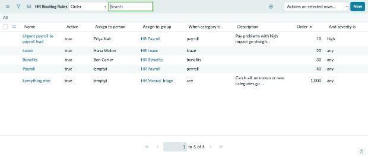 | **A new case is classified and routed** by the matching rule 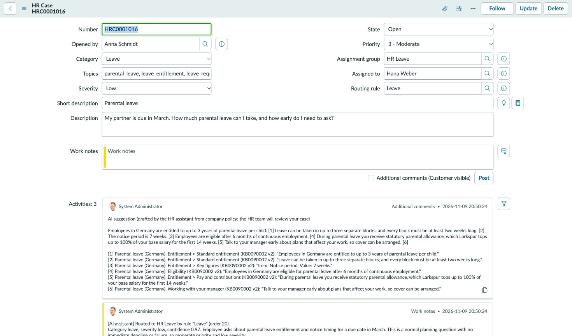 |
| **Cited AI suggestion** posted to the employee, plus the routing note 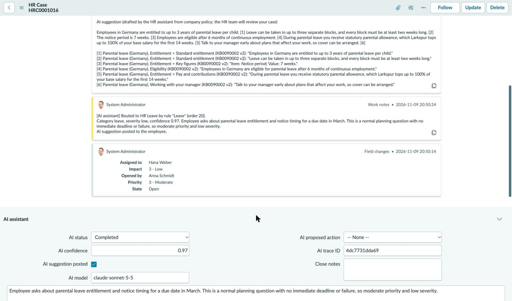 | **AI Citations**: every quote pinned to an article version 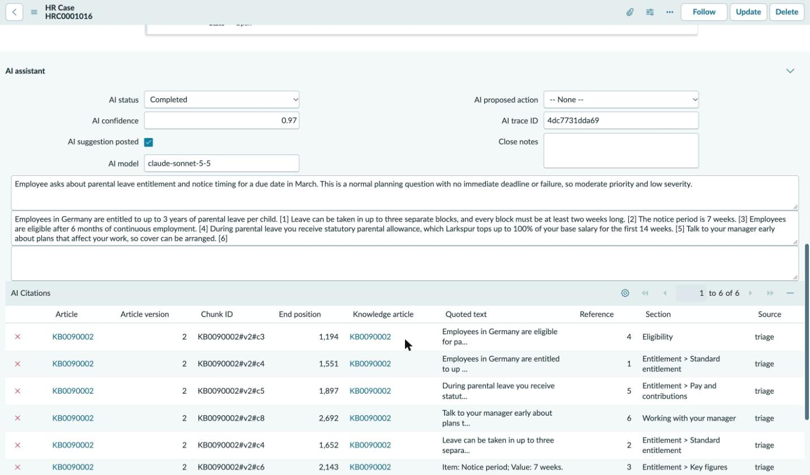 |
| **Same question, US employee**: US policy is quoted 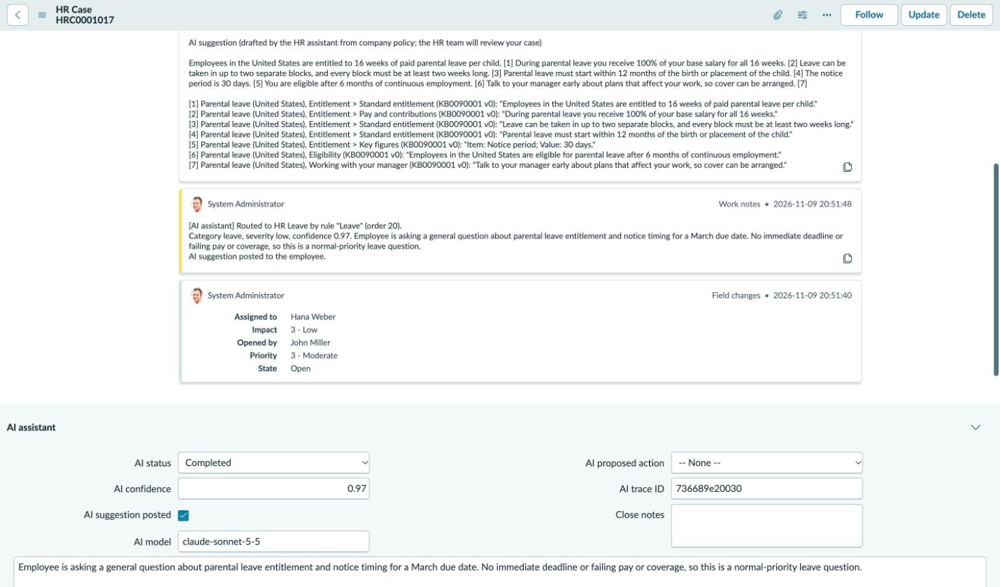 | **HR edits a routing rule** in the UI (no code) 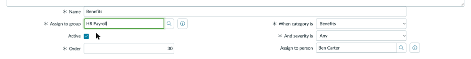 |
| **The next case follows the new rule** 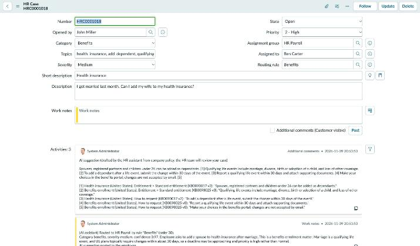 | **Policy article** in the HR knowledge base 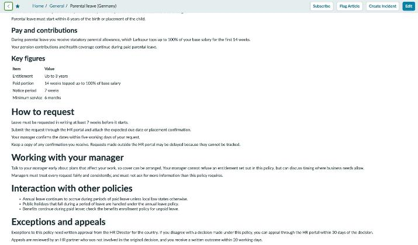 |
| **After a policy edit**, answers quote the new text within seconds 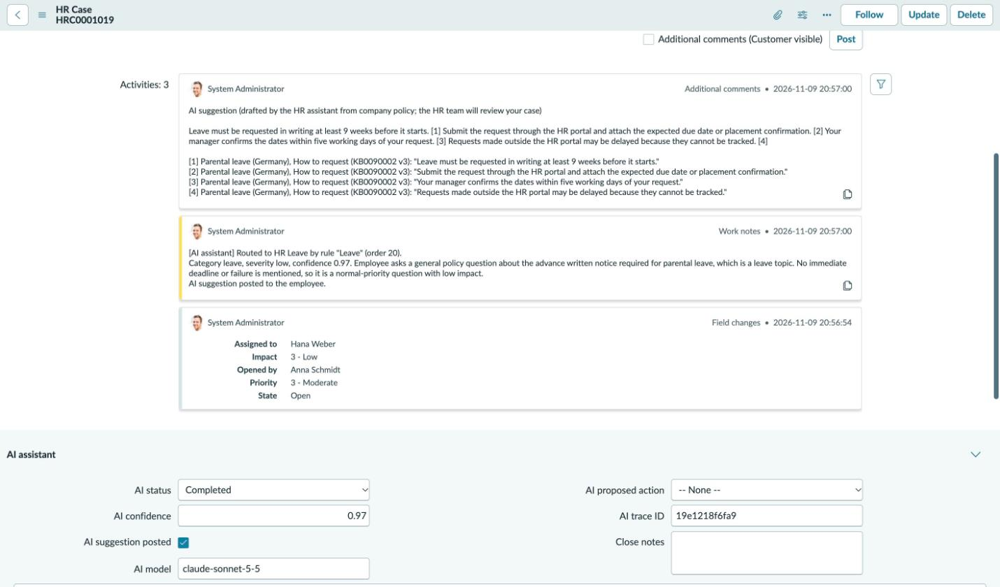 | **@ai proposes closing**, flagging a concern for the reviewer 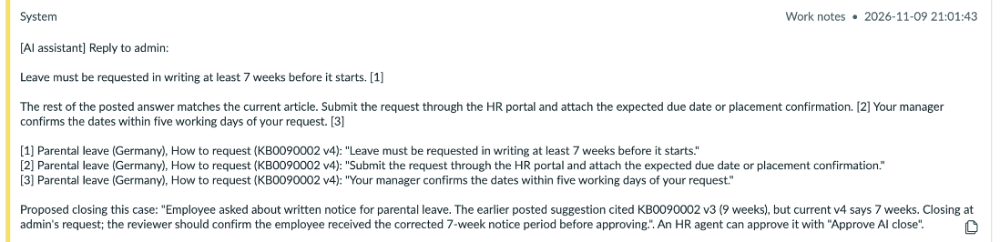 |
| **A person decides**: Approve or Reject AI close 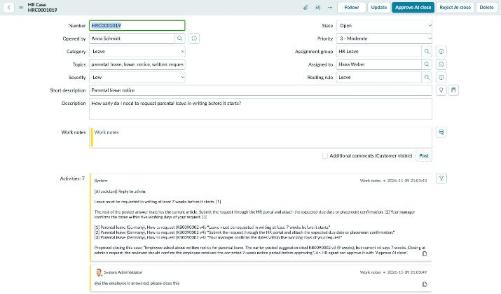 | **Closed after approval**, with the approver recorded 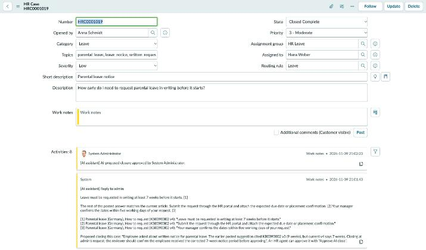 |
| **AI service down**: the case goes to Manual Triage with a reason 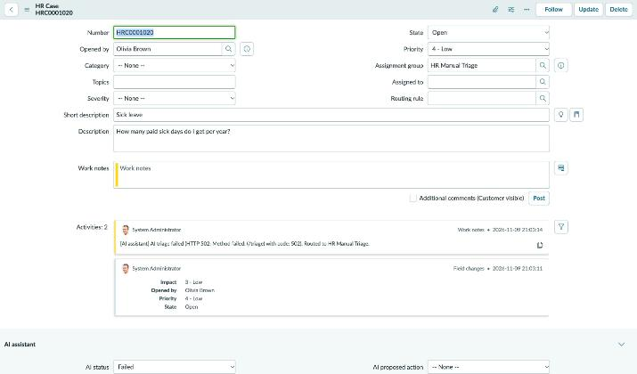 | **Re-run AI triage** after recovery 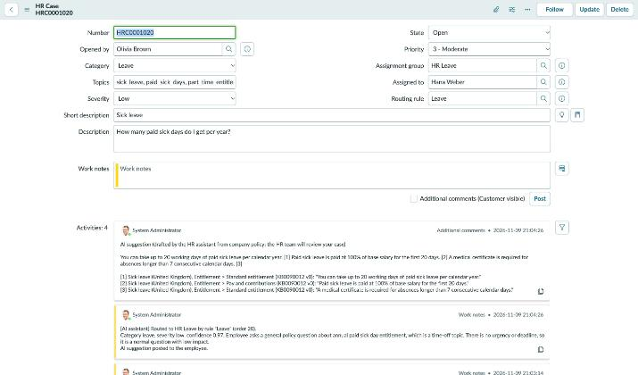 |

## How it works

```
Employee submits a case (Service Portal)
  -> ServiceNow business rule (async) calls the AI service: POST /triage
       classify  ─┐
                  ├─> verify citations -> recommendation (JSON)
       draft  ────┘   (search policies via MCP tools, cite exact sentences)
  -> ServiceNow applies it: routing rules pick the team, AI fields and citations are saved,
     the suggestion is posted to the employee only if it is fully cited and confident enough
HR tags "@ai" in a work note -> POST /chat -> cited reply as a work note, optional close proposal
HR clicks "Approve AI close" -> ServiceNow closes the case and records who approved
A policy article is published or edited -> POST /ingest -> re-indexed within seconds
```

## Run the AI service

Requires Docker.

```bash
cp .env.example .env     # set SERVICE_API_KEY (openssl rand -hex 32) and ANTHROPIC_API_KEY
python3 scripts/generate_corpus.py
docker compose up -d --build
curl localhost:8000/health
```

Expose it to ServiceNow over HTTPS through the gateway (forward TCP 443 to this host first; `PUBLIC_HOST` is a DNS name that resolves to your public IP, for example `<ip-with-dashes>.sslip.io`):

```bash
docker compose --profile public up -d
```

Configuration lives in `.env`; every setting is documented in `ai-service/app/config.py`. Key ones:

| Setting | Meaning |
|---|---|
| `LLM_PROVIDER` | `anthropic`, or `offline` for a deterministic stand-in that needs no key |
| `LLM_MODEL` | Claude model, `claude-sonnet-5-5` by default |
| `KB_SOURCE` | `servicenow` reads the HR knowledge base; `local` reads `corpus/` |
| `SN_*` | Read-only integration user and table names for the ServiceNow Table API |

## Set up the ServiceNow app

```bash
cd servicenow-app
npx now-sdk auth --add https://<instance>.service-now.com --type basic --alias pdi
npm install && npm run build && npx now-sdk install --auth pdi
npx now-sdk exec --auth pdi -f scripts/seed-hr-data.js --scope 77e3b6970d2d4d759440ba33ca5637df --reason "Seed HR data"
sh scripts/configure-agent.sh            # AI service URL and API key, read from ../.env
```

Then set a password for the `hr_ai_integration` user on the instance and put it in `.env` as `SN_PASSWORD`.

HR policies and routing rules are not part of the app package: HR owns them in the ServiceNow UI, and a redeploy must not overwrite their edits. `seed-hr-data.js` creates the starting knowledge base, 51 articles and 5 routing rules once and never changes existing records (regenerate it with `python3 scripts/build_seed_script.py`). The service URL and key are stored as admin-only global properties, so app installs never reset them.

## Tests

Tests run in the stack against a scratch database and the local corpus, so they never touch the live index:

```bash
docker compose exec db psql -U hr -d hr_policies -c "CREATE DATABASE hr_test"   # once
docker compose run --rm -e DATABASE_URL=postgresql://hr:hr@db:5432/hr_test -e KB_SOURCE=local \
  agent pytest -m "not integration"     # citation rules, tool binding, parsing, chunking
docker compose run --rm -e DATABASE_URL=postgresql://hr:hr@db:5432/hr_test -e KB_SOURCE=local \
  agent pytest -m integration           # safety gates over the HTTP API, graph runs via MCP
python3 scripts/check_choice_lists.py   # ServiceNow choice lists match the service's categories
```

On demand, against an indexed database: `docker compose run --rm agent python -m evals.retrieval` (retrieval recall@5) and `python3 scripts/run_scenarios.py` (end-to-end checks against the running API with the real model).

## Design choices worth knowing

- **Exact citations.** Retrieved sentences go to Claude as search results with citations enabled. Each citation is checked word for word against the stored text. Uncited text is allowed only as short connective phrases with no facts in them (no numbers, durations, amounts or policy terms); anything else gets one repair attempt and is otherwise removed, and a draft that needed removals is never posted to the employee.
- **Country-aware answers.** The employee's country comes from their HR Profile or their location. The service, not the model, binds it to every tool call: search only returns that country's policies plus global ones, and a citation to any other country's policy is rejected. If the country is unknown, only global policies are visible and the suggestion goes to HR for review.
- **Human in the loop.** The agent can only propose closing a case. If staff ask it to close, a proposal is always recorded (with any doubts in the resolution) and an HR agent approves or rejects it. A newer triage or @ai request supersedes an open proposal, so only the latest one can be approved. Only HR agents can call the assistant, and only from work notes.
- **Fail safe.** Any AI failure, timeout or invalid response routes the case to HR Manual Triage with a work note explaining why. The service reports failures as stable codes (`llm_refused`, `index_unavailable`, `busy`, ...) and caps how many agent runs happen at once.
- **Agent framework.** The workflow is a LangGraph graph (classification runs in parallel with drafting; a citation-repair loop) and the read-only tools are an MCP server, so other agents can reuse them. Tools run blocking work off the event loop, and the case number and country are bound by the service, not chosen by the model.
- **Least privilege.** The integration user can read cases and HR articles and write nothing.

All data is synthetic. Before using real employee data, add the sensitivity check and redaction described in the backlog.
